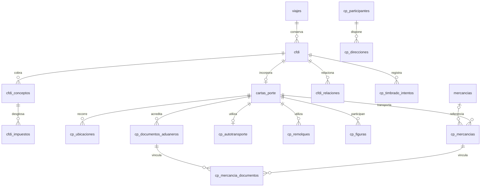
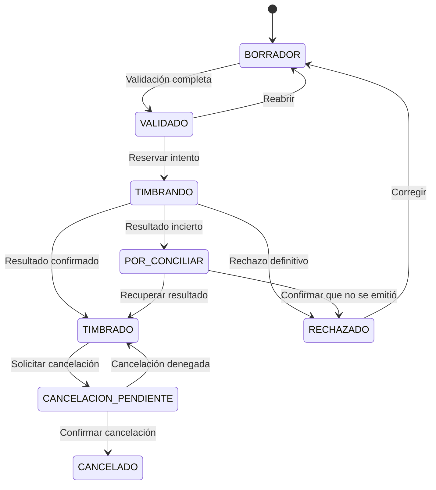

# Diseño del backend de Carta Porte

Diseño e implementación inicial del 21 de octubre de 2026 para integrar los catálogos, la preparación por etapas y la emisión de CFDI con Carta Porte al módulo Logística existente. Incluye autotransporte nacional e internacional, varias mercancías y varios documentos aduaneros. Las rutas y los servicios están creados; la migración sigue pendiente de aplicar y no hay un proveedor fiscal configurado.

## Estado de la implementación

- `routes/carta-porte.js` está montado después de la autenticación TMS. Exige identidad UUID y permisos explícitos, incluso en desarrollo local.
- `services/carta-porte-config.js`, `carta-porte-input.js`, `carta-porte.js` y `carta-porte-validation.js` implementan catálogos, listas cerradas de campos, borradores, apartados, decimales exactos, snapshots, auditoría y control de revisión.
- `services/carta-porte-operations.js` implementa cola transaccional, idempotencia, conciliación, cancelación e importación mediante adaptador inyectado. Exporta `processFiscalOperation`; no inicia un worker automáticamente. La sustitución y la recarga de snapshots se resuelven localmente en el servicio principal.
- `services/carta-porte-storage.js` implementa archivos privados locales con hash, autor y metadatos de `tms.archivos`. No expone un directorio estático. Instanciar el adaptador no escribe archivos ni consulta la base.
- El router acepta `{ pool, provider, files }`. El montaje actual inyecta pool y almacenamiento local; `provider` permanece sin configurar. Emisión, conciliación e importación verificable responden `503 PAC_NOT_CONFIGURED` hasta integrar un proveedor real. No genera XML fiscal ni UUID de timbrado ficticios.
- La validación local detecta faltantes estructurales; solo cambia a VALIDADO si el adaptador completa reglas fiscales, claves oficiales y XSD. No se presenta la revisión local como certificación fiscal.
- La UI conserva su demostración. Estos endpoints todavía no están enlazados a los botones de ejemplo.

La suite de backend incluye `tests/logistica/backend/carta-porte.test.js`, con dobles en memoria; no ejecuta esta migración ni comprueba la base instalada. La matriz específica de visibilidad por cliente/operador sigue pendiente: las rutas actuales son internas para personal con permisos globales TMS, no deben habilitarse directamente a cuentas externas.

La migración es [20261021_carta_porte_catalogos_documentos.sql](../database/migrations/20261021_carta_porte_catalogos_documentos.sql). Se aplica una sola vez, después de comprobar la versión instalada y las migraciones previas de Clientes. Conserva `schema.sql`, no modifica los datos operativos históricos y no asigna permisos a roles.

## Flujo de trabajo

1. Preparar clientes, participantes, domicilios, mercancías, unidades, remolques, operadores, seguros y empresa emisora desde el catálogo.
2. Registrar el viaje confirmado con el servicio y datos operativos existentes. La Carta Porte es opcional en esa transacción inicial y admite información parcial.
3. Crear el borrador de CFDI y Carta Porte asociado al viaje. Seleccionar datos de los catálogos y copiar sus valores al documento.
4. Completar cantidades, pesos, equipo definitivo, documentos aduaneros y datos de carga durante la operación.
5. Validar el documento completo. La validación devuelve campos pendientes, errores y advertencias sin inventar valores fiscales.
6. Timbrar desde Viajes, conciliar el resultado y guardar el XML y la representación PDF. No exigir POD ni viaje entregado para emitir antes de salir.
7. Relacionar el comprobante con Finanzas. Los extras posteriores se resuelven mediante el proceso fiscal aplicable; no se modifica un CFDI emitido ni se vuelve a cobrar automáticamente el flete ya facturado.

El estado operativo del viaje, el estado fiscal del CFDI y el estado de preparación del cobro conservan significados diferentes. Cancelar un viaje no cancela su comprobante; cancelar un comprobante tampoco cancela automáticamente el viaje.

## Conexión con el módulo actual

| Recurso existente | Uso en el diseño |
| --- | --- |
| `clientes` | Receptor del servicio, datos fiscales y posible participante vinculado |
| `cliente_direcciones` | Fuente de domicilios reutilizables, preservando su relación actual con el cliente |
| `proveedores` | Transportista externo y posible participante; no convertir al proveedor en cliente |
| `unidades`, `cajas`, `operadores` | Recursos disponibles; sus datos se copian al documento |
| `tipos_servicio` | Clasificación fiscal predeterminada de conceptos como flete |
| `viajes`, `viaje_tiempos` | Viaje y fechas operativas; no son por sí solos un documento fiscal |
| `viaje_carga` | Resumen operativo; las partidas fiscales viven en `cp_mercancias` |
| `viaje_comercial`, `viaje_extras` | Origen de importes propuestos para revisión, no autorización automática de impuestos |
| `viaje_eventos` | Resumen operativo de creación, emisión, rechazo o cancelación |
| `archivos` y documentos de recursos | XML/PDF/acuse y comprobantes de pólizas o licencias |
| `viaje_facturacion_operativa` | Preparación y seguimiento del cobro; no crear otro estado de Carta Porte aquí |
| `viaje_referencias_finanzas` | Relación al mismo CFDI y al mismo viaje mediante clave foránea compuesta |

La UI del catálogo continúa siendo demostrativa hasta implementar estos servicios. No conectar sus ejemplos con las tablas reales ni cargarlos como semillas fiscales.

## Modelo de datos

La migración agrega 26 tablas. Las tablas de documento permiten nulos durante la captura parcial; el servicio de validación exige todos los campos y condiciones aplicables antes de emitir.

| Grupo | Tablas nuevas | Responsabilidad |
| --- | --- | --- |
| Referencias oficiales | `cp_sat_versiones`, `cp_sat_claves` | Identificar revisión, fuente, checksum y vigencias de las claves SAT |
| Catálogos | `empresas_emisoras`, `mercancias`, `cp_participantes`, `cp_direcciones`, `unidad_seguros` | Preparar información reutilizable |
| CFDI | `cfdi`, `cfdi_conceptos`, `cfdi_impuestos`, `cfdi_relaciones` | Identidad fiscal, servicios cobrados, impuestos y sustituciones |
| Carta Porte | `cartas_porte`, `cp_ubicaciones`, `cp_mercancias`, `cp_autotransporte`, `cp_remolques`, `cp_figuras`, `cp_figura_partes` | Datos efectivos del traslado |
| Casos condicionados | `cp_mercancias_sanitarias`, `cp_regimenes_aduaneros`, `cp_documentos_aduaneros`, `cp_mercancia_documentos`, `cp_cantidades_transportadas`, `cp_guias` | Información sanitaria, aduanas, distribución de mercancía y guías |
| Operación y auditoría | `cp_timbrado_intentos`, `cp_auditoria` | Operaciones al PAC, idempotencia, conciliación e historial |

### Relaciones



Un viaje puede conservar varios comprobantes: propios, recibidos de proveedores, cancelados o sustitutos. Cada CFDI admite como máximo una Carta Porte. Antes de crear una emisión propia nueva, el servicio bloquea el viaje y revisa los documentos existentes: una emisión adicional requiere motivo y alcance explícitos, por ejemplo una sustitución o un traslado distinto. No se declara una restricción universal de una sola Carta Porte vigente por viaje porque impediría esos escenarios.

Las claves foráneas compuestas impiden relacionar una partida con documentos o ubicaciones de otra Carta Porte. Un pedimento puede relacionarse con varias partidas y una partida con varios documentos. Los registros de origen/destino deben tener el tipo correcto y orden coherente; esta última validación es del servicio.

### Modificaciones a tablas actuales

- Clientes: residencia fiscal SAT y número de identificación tributaria. Se conserva la unicidad de RFC particulares y se excluyen los genéricos `XEXX010101000` y `XAXX010101000` del índice único; país fiscal e identificación extranjera forman una identidad adicional cuando están disponibles. No fusionar clientes por RFC genérico.
- Direcciones: números, colonia, localidad, municipio, referencia y claves SAT separados del texto de presentación. `pais` actual conserva dos caracteres; `pais_sat` contiene la clave del catálogo fiscal. No copiar `MX` al campo fiscal que espera `MEX`.
- Unidades: configuración, permiso, número, peso vacío, referencia de peso permitido, VIN y dimensiones internas. Cajas: subtipo, peso vacío y dimensiones complementarias.
- Operadores: RFC, número de licencia, vencimiento de control interno y datos extranjeros/domicilio. Los archivos previos del expediente se conservan.
- Tipos de servicio: claves predeterminadas para el concepto fiscal y objeto de impuesto. Las tasas no se fijan universalmente en 16 %, 4 % o cero.
- Referencias de Finanzas: vínculo opcional a `cfdi`, conservando los identificadores externos existentes.

Agregar estos campos a SQL no cambia las validaciones ni los cuerpos de las rutas actuales. La implementación debe ampliarlos explícitamente, en particular la búsqueda de duplicados de cliente y la captura de países extranjeros.

### Copias del documento

Las referencias a catálogos sirven para trazabilidad; el XML se genera con los valores copiados al documento. Emisor, receptor, participante y domicilio usan objetos JSON con contrato estricto. Mercancías, vehículos, remolques, figuras y seguros tienen columnas propias para los valores definitivos.

Un cambio de catálogo no se propaga al documento. En borrador se permite una acción explícita de recargar datos con comparación de cambios y nueva revisión. Un documento validado debe volver primero a borrador. Los emitidos conservan identidad fiscal, datos y XML; la corrección se tramita con cancelación y sustitución según corresponda.

Contrato de `domicilio` y `domicilio_snapshot`: `calle`, `numero_exterior`, `numero_interior`, `colonia`, `localidad`, `municipio`, `estado`, `pais`, `codigo_postal`, `referencia`, `pais_sat`, `estado_sat`, `municipio_sat`, `localidad_sat`, `colonia_sat`. Rechazar claves adicionales y tipos distintos de cadena o nulo. Los snapshots fiscales de emisor/receptor agregan `rfc`, `nombre`, `regimen_fiscal_sat`, `domicilio_fiscal_cp`, `residencia_fiscal_sat` y `numero_registro_tributario`, con los requisitos particulares de cada nodo. `emisor_snapshot` nunca incluye `csd_secret_ref`.

Los catálogos sanitarios de referencia pueden ampliarse después; en este diseño sus datos efectivos se capturan por lote en `cp_mercancias_sanitarias`. No heredar lote, caducidad o permisos de otro traslado.

## Organización del backend

Mantener Express, `pg.Pool`, JWT y permisos TMS actuales. Los archivos siguientes son destinos propuestos, todavía sin implementación:

```text
modules/logistica/
  routes/
    carta-porte-catalogs.js
    carta-porte-documents.js
    carta-porte-stamping.js
  repositories/
    carta-porte-catalogs.js
    carta-porte-documents.js
    carta-porte-audit.js
  services/
    carta-porte-drafts.js
    carta-porte-validation.js
    carta-porte-snapshots.js
    carta-porte-xml.js
    carta-porte-stamping.js
    carta-porte-reconciliation.js
    carta-porte-pdf.js
    carta-porte-import.js
  integrations/pac/
    adapter.js
    selected-provider.js
  validators/
    carta-porte-input.js
    carta-porte-sat-rules.js
```

La implementación inicial concentra consultas parametrizadas en `services/carta-porte.js`; separar repositorios es una organización futura y no un requisito de funcionamiento. Las rutas validan entrada y permisos y los servicios controlan transacciones y reglas. El adaptador del PAC recibe el agregado y debe verificar el tratamiento fiscal antes de validarlo; no altera datos operativos.

## Contrato HTTP propuesto

Prefijo `/api/logistica`. El folio es el folio operativo existente; los identificadores de documento son UUID. Las rutas están montadas, pero no podrán persistir hasta aplicar la migración y asignar permisos. Si faltan tablas o columnas responden `503 SCHEMA_NOT_READY`.

### Catálogos

| Método y ruta | Función |
| --- | --- |
| `GET /carta-porte/catalogs/summary` | Conteos y pendientes reales, sin mezclar ejemplos |
| `GET, POST /carta-porte/catalogs/merchandise` | Buscar o crear mercancías |
| `GET, PATCH /carta-porte/catalogs/merchandise/:id` | Consultar o editar ficha |
| `PATCH /carta-porte/catalogs/merchandise/:id/active` | Desactivar o reactivar |
| Mismo patrón con `participants`, `addresses`, `issuers`, `insurance` | Catálogos nuevos con listas de campos propias |
| `GET /carta-porte/sat/:catalog?date=...&q=...&version_id=...` | Claves oficiales de la revisión elegida |

Clientes, flota y operadores conservan sus rutas actuales. Los recursos adicionales `customers`, `customer-addresses`, `units`, `trailers` y `operators` bajo `/carta-porte/catalogs` operan sobre esas mismas tablas, con campos fiscales y permisos del módulo propietario además de `carta_porte.catalogos.editar`. No crean copias de clientes ni unidades. Las rutas antiguas no cambian sus cuerpos de entrada. Los nombres de tabla se toman exclusivamente de una lista cerrada. La desactivación de unidades/remolques se rechaza en este catálogo para conservar el flujo de estados y bloqueos de Flota.

Para `POST` enviar un objeto con los campos declarados en `carta-porte-config.js`. Para `PATCH` y `/active` agregar `expected_updated_at` con la fecha recibida. Los decimales se envían como cadenas, por ejemplo `"peso_kg": "8174.000"`; los enteros y booleanos mantienen sus tipos JSON. No se permite enviar `estado`, claves de timbrado, snapshots ni columnas desconocidas.

En los apartados del documento, cada grupo recibe `{ "expected_revision": "4", "merchandise": { "upsert": [...], "remove": [...] } }`, usando los nombres del grupo de `carta-porte-config.js`. `upsert` admite hasta 100 filas por colección. Las claves de `remove` son objetos: `{ "id": "uuid" }` o las claves compuestas del vínculo. Se eliminan dependencias primero; no existe borrado en cascada. Una operación de lote es transaccional.

Las direcciones vinculadas a `cliente_direcciones` toman esa ficha como fuente al leer. Las actualizaciones de identidad vinculada se dirigen al cliente/proveedor original dentro de una transacción; no mantener dos versiones maestras divergentes. Para una dirección independiente se usa `cp_direcciones`. Comprobar que el cliente de la dirección coincida con el del participante vinculado.

### Documentos del viaje

| Método y ruta | Función |
| --- | --- |
| `GET /trips/:folio/carta-porte` | Listar documentos propios, externos e históricos con estados |
| `POST /trips/:folio/carta-porte` | Crear borrador, CFDI y primera copia de datos |
| `GET /carta-porte/:id` | Consultar el agregado completo y la revisión del CFDI |
| `PATCH /carta-porte/:id` | Editar cabecera permitida del borrador |
| `POST /carta-porte/:id/reopen` | Volver de validado/rechazado a borrador antes de editar |
| `POST /carta-porte/:id/refresh-snapshots` | Recargar explícitamente selecciones de catálogo en borrador |
| `PUT /carta-porte/:id/locations` | Reconciliar ubicaciones, conservando IDs que ya se utilizan |
| `PUT /carta-porte/:id/merchandise` | Reconciliar partidas y sus datos sanitarios |
| `PUT /carta-porte/:id/transport` | Unidad, remolques, figuras, partes y seguros |
| `PUT /carta-porte/:id/customs` | Regímenes, documentos y vínculos a partidas |
| `PUT /carta-porte/:id/allocations` | Cantidades entre pares origen/destino y guías aplicables |
| `PUT /carta-porte/:id/invoice-items` | Conceptos, impuestos y totales calculados |
| `POST /carta-porte/:id/validate` | Devolver errores; cambiar a VALIDADO solo si pasa |
| `POST /carta-porte/:id/stamp` | Crear intento durable; responder 202 y URL de seguimiento |
| `GET /carta-porte/:id/operations/:operationId` | Consultar resultado, incluyendo pendientes de conciliación |
| `POST /carta-porte/:id/reconcile` | Consultar resultado incierto sin crear otra emisión |
| `POST /carta-porte/:id/cancel` | Solicitar cancelación fiscal con motivo y sustituto si aplica |
| `POST /carta-porte/:id/replacement` | Crear nuevo borrador y relación fiscal al comprobante anterior |
| `GET /carta-porte/:id/files/:kind` | Descargar XML, PDF o acuse mediante autorización |
| `GET /carta-porte/:id/events` | Auditoría permitida para el usuario |
| `POST /trips/:folio/carta-porte/import` | Importar XML de proveedor y relacionarlo al viaje |

En `PUT` no borrar y recrear indiscriminadamente: hacer diff de IDs, verificar pertenencia, actualizar y eliminar primero dependencias permitidas de borrador. Las claves foráneas no tienen borrado en cascada. En importación, primero crear BORRADOR externo, poblar hijos y después finalizar TIMBRADO en la misma transacción. Requerir XML válido con timbre verificable y UUID único; un PDF aislado queda como evidencia, no como CFDI fiscal verificado.

### Respuestas y concurrencia

Mantener `{ "success": true, "data": ... }`. Para errores agregar código estable y rutas de campo:

```json
{
  "success": false,
  "error": "Falta completar información para emitir",
  "code": "CARTA_PORTE_INCOMPLETE",
  "fields": [
    { "path": "transport.placas", "code": "REQUIRED", "message": "Captura las placas" },
    { "path": "merchandise[0].peso_kg", "code": "REQUIRED", "message": "Confirma el peso" }
  ]
}
```

Todas las mutaciones del agregado reciben `expected_revision`; timbrar/cancelar además reciben `Idempotency-Key` UUID. No permitir al cliente fijar estado fiscal, UUID, actor, totales definitivos o sellos. Los identificadores `IdCCP` de documentos propios se generan en el servidor/base con patrón vigente; los externos conservan el del XML.

- 400: formato, IDs o campos desconocidos.
- 401/403: sesión o permisos.
- 404: recurso inexistente o no visible dentro del alcance del usuario.
- 409: revisión desactualizada, pertenencia incorrecta o documento bloqueado.
- 422: reglas fiscales o información incompleta.
- 503: dependencia indisponible. Después de un envío incierto, responder estado POR_CONCILIAR con identificador del intento; no declarar rechazo fiscal.

## Transacciones e integridad

Para editar un documento: abrir transacción, bloquear `cfdi` con `FOR UPDATE`, comprobar estado y `expected_revision`, modificar hijos, recalcular lo necesario, registrar auditoría y confirmar. Los triggers de detalle incrementan `cfdi.revision` y limpian el payload validado. La revisión puede avanzar varias veces por operación: es una versión opaca, no un contador de clics. Responder con el valor final.

Para creación, importación o sustitución bloquear primero `viajes`, después los CFDI implicados en orden de UUID y luego sus hijos. Todas las rutas y workers respetan ese orden. No mantener una transacción PostgreSQL abierta mientras se llama al PAC.

Para sumar partidas al resumen operativo, designar explícitamente el borrador propio activo como fuente. No sumar comprobantes externos, sustituidos o cancelados; no duplicar peso por tener dos comprobantes del mismo traslado. La sincronización de asignaciones comprueba permisos y disponibilidad mediante los servicios existentes. Si cambia la unidad u operador del viaje después de preparar el borrador, marcar diferencia y exigir revisión antes de emitir, sin actualizar documentos emitidos.

No borrar físicamente catálogos referenciados: usar `activo=false`. Los documentos completos, incluso los cancelados, se conservan. La auditoría se inserta dentro de cada transacción con actor real, entidad, motivo y cambios pertinentes, excluyendo credenciales y datos innecesarios. El trigger append-only protege `cp_auditoria`; los triggers no generan automáticamente sus filas.

## Validación fiscal

Usar una revisión concreta de CFDI, Carta Porte, XSD, catálogos y reglas adicionales. `cp_sat_versiones` identifica la revisión y `cp_sat_claves` sus claves y vigencias; no insertar listas inventadas ni derivar claves de textos libres sin confirmación. La correspondencia entre cada columna `*_sat` y el nombre exacto de su catálogo es una lista cerrada en `carta-porte-sat-rules.js`. Los campos de catálogo parcial no llevan FK a una revisión fija: al validar el documento se cotejan con la revisión seleccionada y la fecha de emisión.

Validaciones mínimas propuestas:

1. Emisor/receptor, RFC, nombres, régimen, CP, uso CFDI, tipo de comprobante y datos extranjeros según el caso. No usar RFC genérico como identificador único del cliente.
2. Origen y destino, domicilios, tipos de participante, claves geográficas, zona horaria, orden de fechas, distancias y coherencia del cruce internacional.
3. Partidas, cantidades, claves, unidades, dimensiones cuando se capturan, pesos y totales. Usar aritmética decimal en el servicio; no `Number` para cálculos monetarios fiscales.
4. Configuración real del conjunto, placas, año, permiso, remolques permitidos, operador/licencia y pólizas del tipo y unidad correctos, vigentes para el traslado.
5. Material peligroso: clasificación, embalaje y seguro aplicables; no exigirlos universalmente ni asumir que un booleano HAZMAT resuelve todo.
6. Internacional: entrada/salida, país, vía, regímenes, tipo de materia, documentos por partida y datos de importador cuando correspondan. No volver obligatoria una fracción arancelaria por el mero hecho de que la plantilla PDF tenga esa columna.
7. Cantidades por origen/destino cuando se utilizan: tipos correctos y sin duplicar cantidades al sumar recorridos de la misma carga. Guías y datos sanitarios según la mercancía.
8. Conceptos e impuestos con el tratamiento aplicable a I/T; importes, descuentos, monedas, tipo de cambio y redondeos. Impuesto exento y tasa cero son casos distintos.
9. Registro Istmo y demás condiciones especiales solo cuando aplican.
10. XML resultante contra XSD y reglas vigentes antes del envío.

Los campos de STCC, estaciones ferroviarias o navegación marítima no se implementan como obligatorios de autotransporte. La documentación de referencia distingue bloques y condiciones; el diseño de tablas no sustituye esa validación.

`PesoBrutoVehicular` merece cotejo expreso: el XSD oficial consultado lo describe como peso bruto vehicular permitido; el instructivo contiene una explicación basada en vehículo y carga. El backend debe cerrar su interpretación con la revisión vigente y el PAC, conservar unidades en toneladas y no copiar automáticamente capacidad en kg. Los ejemplos impresos no son una fuente para calcularlo ni para validar cifras.

## Estados y proveedor de timbrado



El flujo externo importado tiene la excepción BORRADOR → TIMBRADO después de verificar el XML. No enviar estos documentos al PAC de WTG. La importación de comprobantes ya cancelados requiere consultar/registrar su situación fiscal, no inferirla del PDF.

### Envío durable

1. Bloquear CFDI y comprobar revisión, estado VALIDADO, origen PROPIO y ausencia de una operación fiscal abierta.
2. Serializar y firmar el XML con el CSD correspondiente. Resolver `csd_secret_ref` en el servidor; jamás almacenar llave/contraseña en snapshots, respuestas o logs. Persistir el XML firmado exacto en almacenamiento privado y obtener su hash antes de insertar el intento. El snapshot del intento incluye la referencia al artefacto durable. Si falla la transacción, el objeto sin referencia queda para limpieza controlada.
3. Dentro de la transacción insertar `cp_timbrado_intentos` PENDIENTE con payload normalizado, hash e idempotencia. Guardar el snapshot en CFDI y pasar a TIMBRANDO. Confirmar.
4. Un worker toma intentos pendientes con `FOR UPDATE SKIP LOCKED`, cambia a ENVIADO y confirma antes de contactar al PAC. Un ENVIADO abandonado por caída del proceso pasa a conciliación, no se reenvía a ciegas.
5. Fuera de transacción enviar el XML durable mediante el adaptador. Verificar que su hash coincida con el del intento. No reconstruirlo desde catálogos actuales ni cambiar el snapshot después de insertar el intento.
6. Abrir otra transacción para registrar resultado confirmado, sellos, UUID, hora, XML original timbrado y auditoría. Marcar TIMBRADO solo si ya existe un XML durable referenciado en `archivos`; si falla el almacenamiento después de emitir, conservar POR_CONCILIAR y recuperar del PAC.
7. Generar PDF desde los datos y XML confirmados. Un fallo de PDF no invalida el timbrado; se reintenta la representación sin emitir otro CFDI.

Repetir la misma clave idempotente devuelve el mismo intento, salvo que cambien documento, operación o hash: en ese caso responder 409. Una nueva clave no permite saltarse el bloqueo de una emisión en curso. Cada consulta de conciliación deja su propio intento CONSULTAR y actualiza el intento fiscal original sin alterar su solicitud.

El adaptador debe ofrecer `stamp`, `lookup`, `cancel` y `cancellationStatus`, con contrato uniforme de resultado aceptado, rechazado o incierto. No depender de callbacks si el proveedor no los soporta. Si se usan webhooks, verificar autenticidad, deduplicar y hacer que el mismo procesador transaccional aplique los resultados.

No se elige un PAC ni se asumen sus endpoints, precios o autenticación en este diseño. Para producción se requieren proveedor, sandbox, custodia del CSD, reglas de cancelación, almacenamiento privado y un worker durable.

## Seguridad y permisos

Reutilizar `requireLogisticsUser` con un UUID TMS real y autorización por acción. No heredar el bypass de desarrollo para edición, emisión, importación o cancelación. Los permisos propuestos son:

| Permiso | Alcance |
| --- | --- |
| `carta_porte.catalogos.ver`, `carta_porte.catalogos.editar` | Catálogos; combinar con permisos existentes al editar Clientes o Flota |
| `carta_porte.ver`, `carta_porte.editar` | Consulta y captura del documento |
| `carta_porte.validar` | Validación previa |
| `carta_porte.timbrar` | Emisión y conciliación |
| `carta_porte.cancelar` | Cancelación y sustitución autorizada |
| `carta_porte.importar` | Comprobantes externos |

Además del permiso general, comprobar acceso al viaje y a su cliente/proveedor. No basta conocer un UUID. Portales de operador y cliente no reciben el CFDI completo ni todas las identidades por defecto: definir una representación permitida para el operador y campos visibles según rol, preservando los datos obligatorios aplicables.

RLS queda habilitado sin políticas ni GRANT nuevos, conforme al esquema actual. Antes de habilitar endpoints se debe definir el rol de conexión y las políticas/privilegios del despliegue. No conectar al navegador con un rol propietario ni exponer una clave de servicio. Los permisos de aplicación no reemplazan el control de acceso SQL.

La representación PDF no es la fuente fiscal. Proteger XML, PDF y acuses con autorización y almacenamiento privado. La ruta de evidencias actual no admite XML: crear un flujo específico con validación de tamaño, estructura, entidad XML externa deshabilitada, hash y acceso controlado. No reutilizar su lista de MIME sin cambios.

## Entregas y verificación prevista

1. Cotejar esquema instalado, respaldo y ensayo manual de migración en una base aislada, con autorización separada. El SQL entregado no se ejecuta como parte de esta tarea.
2. Implementar catálogos y extensiones existentes; verificar persistencia y desactivación.
3. Implementar borrador del viaje, snapshots, concurrencia, mercancías y documentos aduaneros múltiples.
4. Implementar reglas, versión SAT y generación XML con pruebas representativas.
5. Conectar PAC en sandbox; verificar emisión, timeout, conciliación, cancelación y sustitución.
6. Integrar archivos, permisos del operador y referencia a Finanzas antes de producción.

Las pruebas futuras se ubican en `tests/logistica/backend`, separadas de frontend. Deben cubrir: varios clientes extranjeros con RFC genérico; dirección independiente de quien paga; claves cruzadas entre cartas rechazadas; múltiples partidas/pedimentos; caducidad de pólizas; material peligroso; viaje nacional/internacional; importe cero frente a exento; cambios concurrentes; cambio de catálogo sin modificar documentos; bloqueo de hijos tras validar o emitir; idempotencia con claves iguales y distintas; timeout después de emisión; caída del worker; recuperación de XML; cancelación pendiente; sustitución sin pérdida de historia; importación de proveedor sin timbrarlo otra vez; permisos y alcance por cliente.

La migración debe verificarse con PostgreSQL real en un entorno de ensayo antes de aplicarse. Una lectura estática o un parser SQL no comprueba la ejecución de PL/pgSQL, permisos, triggers ni compatibilidad con la base instalada.

## Adaptadores pendientes de configuración

`provider` debe declarar `name`, `environment` (`PRUEBAS` o `PRODUCCION`) y los métodos `validate`, `prepare`, `stamp`, `lookup`, `cancel`, `cancellationStatus` y `verifyImport`. `validate` y `prepare` son locales: reglas SAT, XSD, firma con CSD y serialización. No realizan llamadas al PAC dentro de una transacción. `prepare` devuelve `{ valid, xml, errors }`. Los métodos de red devuelven `status: ACCEPTED | REJECTED | UNKNOWN`; un timeout o una respuesta no interpretable queda por conciliar.

En emisión aceptada se requieren `uuid`, `xml`, `timbradoAt` y los datos del timbre. Cancelación aceptada requiere `acknowledgment`. `verifyImport` devuelve un agregado normalizado, verificado y con IDs internos propios, sin referencias arbitrarias a catálogos; debe rechazar entidades XML externas, firmas inválidas y pertenencia incompatible con el viaje. La importación no emite un comprobante nuevo.

El XML de proveedor puede subirse mediante `POST /carta-porte/files/xml`, multipart `file`, máximo 10 MB, con permiso `carta_porte.importar`; la respuesta `{ id, verified: false }` identifica un archivo sin certificar. La importación posterior utiliza ese ID y verifica su autor. Un archivo subido por sí solo nunca marca el viaje como timbrado.

El worker procesa una operación por invocación. Un proceso de la aplicación debe llamar a `processFiscalOperation({ pool, provider, files })` con límite de tiempo del PAC inferior a dos minutos y backoff entre conciliaciones; el módulo recupera envíos abandonados mediante consulta, no mediante reemisión. El despliegue del worker y el adaptador del PAC quedan pendientes de configuración; no hay llamadas reales al SAT o al PAC en esta entrega.

El almacenamiento local admite `write({ content, mime, name, actor, db? })` y `read(id, { actor, authorizedDocument?, system? })`. Las opciones privilegiadas solo provienen del servicio después de autorización o del worker. En producción sustituirlo por almacenamiento privado durable compartido entre API y worker, conservando ese contrato. Los objetos cuyo registro se revierte en una transacción quedan sujetos a limpieza controlada de huérfanos.

## Referencias

- [Instructivo del SAT para autotransporte y Carta Porte 3.1](https://ampocdevbuk01a.s3.us-east-1.amazonaws.com/Instructivo_Complemento_Carta_Porte_Autotransporte_31_20250430_993c8b3059.pdf).
- [Esquema técnico oficial Carta Porte 3.1](https://www.sat.gob.mx/sitio_internet/cfd/CartaPorte/CartaPorte31.xsd).
- [Portal del SAT de Carta Porte](https://www.sat.gob.mx/portal/public/tramites/complemento-carta-porte).

Las capturas aportadas se usan como referencia operativa nacional e internacional, sin transcribir sus RFC, nombres, domicilios, pólizas ni UUID como datos de prueba. Este diseño amplía el planteamiento anterior para admitir comprobantes recibidos y datos sanitarios por lote; no presupone que todos esos casos sean obligatorios en cada viaje.
